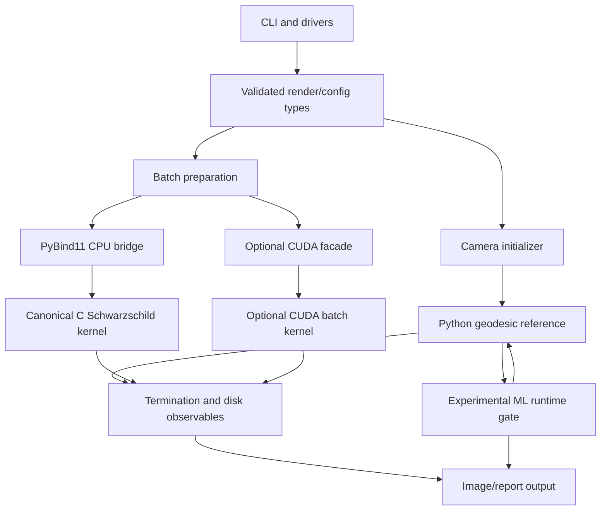

# Architecture — blackhole_ray_tracer

This document summarizes stable boundaries. Detailed execution remains in [`tasks/plan.md`](../tasks/plan.md).

## Design rule

Python remains the inspectable reference. Native backends accelerate the same state transition and result contract. Optional ML and CUDA paths cannot silently redefine correctness.

## Layer map

## Components

| Boundary | Current location | Responsibility |
|---|---|---|
| CLI | `src/blackhole_ray_tracer/main.py`, `*_driver.py` | Parse commands and select workflows |
| Config and result types | `phase2_types.py`, `phase3_types.py` | Define validated inputs and returned data |
| Python Schwarzschild | `phase2_christoffel.py`, `phase2_geodesic.py` | Reference Christoffel/RK4 integration |
| Python Kerr | `phase3_christoffel.py`, `phase3_geodesic.py` | Boyer–Lindquist reference prototype |
| Camera | `phase2_camera.py`, `phase3_camera.py` | Build Schwarzschild static or Kerr ZAMO initial null state |
| Disk observables | `phase2_disk.py`, render modules | Detect crossing and color output |
| C kernel | `kernel/include`, `kernel/src` | Native RK4, Schwarzschild tracing, and bounded Kerr algebra, camera, single-ray tracing, crossing, and disk observables |
| CPU bridge | `bridge/module_phase2.cpp` | Convert NumPy arrays to kernel calls |
| CUDA facade | `native_phase2_cuda.py` | Load and call optional shared library |
| ML | `ml/` | Generate data, infer surrogate output, fallback |

## Data contract

Phase 2 state uses `(t, r, theta, phi, v^t, v^r, v^theta, v^phi)`. Batch input is row-major `(N, 8)` `float64`. Batch output arrays use explicit `int32` and `float64` dtypes. See [PROJECT_CONTRACT.md](./PROJECT_CONTRACT.md) and [STATE_API.md](./STATE_API.md).

## Reference and acceleration paths

- Python Phase 2 is the numerical reference until parity evidence selects another oracle.
- C scalar and batch paths must share one Schwarzschild implementation.
- PyBind11 owns memory conversion and error reporting, not physics.
- CUDA owns device execution and host transfer, not alternate status semantics.
- ML is opt-in and must fall back to trusted integration on invalid or failed inference.

## Current architectural risks

- CUDA parity remains unqualified locally without `nvcc` and compatible runtime hardware.
- Kerr native color rendering, batch, bridge, and CUDA paths remain intentionally unqualified.
- ML accuracy remains experimental and must not enter quality-sensitive routing.
- High-resolution rendering, anti-aliasing, and physical radiative transfer remain out of scope.

T03–T18 resolved canonical C, disk observables, Kerr Python validation, Kerr algebra, single-ray, camera,
crossing, and native disk hit/Doppler parity. ML boundaries and host-side CUDA risks remain explicit.
Future Kerr disk color/rendering still require separate acceptance.
