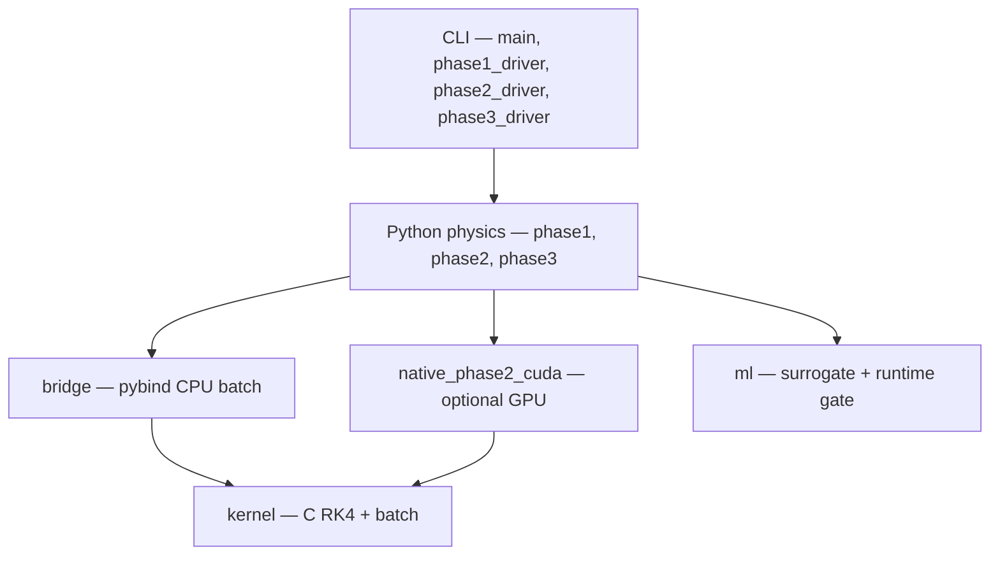

# Project overview — blackhole_ray_tracer

## Purpose

Simulate **null geodesics** (light rays) in strong gravity, starting with Schwarzschild and extending to a validated Python Kerr prototype.
See [STATUS.md](./STATUS.md) for qualification evidence and claim boundaries.
See [ROADMAP.md](./ROADMAP.md) for phases and acceptance criteria, [AGENT_PROMPT.md](./AGENT_PROMPT.md) for session starters, and [STATE_API.md](./STATE_API.md) for the frozen Phase 2 FFI contract.

## What exists today vs planned

### Implemented (Python)

Under `src/blackhole_ray_tracer/`:

| Area | Modules | Role |
|------|-----------|------|
| **Phase 1** | `phase1.py`, `phase1_driver.py`, `phase1_image.py`, `phase1_tuning.py` | RK4 sanity (harmonic oscillator), equatorial Schwarzschild tracing in \(u(\phi)=1/r\), single ray logging, batch impact-parameter sweeps, simple **Einstein ring**–style PPM, tuning presets/report |
| **Phase 2** | `phase2_*.py` | Spherical Schwarzschild **Christoffel + RK4** in affine parameter; static observer **pinhole** camera; **3D shadow** PPM; optional native **CPU/CUDA batch** path with disk overlay; presets/benchmark |
| **Phase 3** | `phase3_*.py` | Python-only Kerr Boyer–Lindquist prototype; ZAMO camera; invariant/convergence tests; spin-dependent disk ISCO; render/report/CLI |
| **Entry** | `main.py`, `phase1_driver`, `phase2_driver`, `phase3_driver`, `preview.py` | User-facing CLI |
| **Bridge (optional)** | `native_phase2.py`, `native_phase2_cuda.py`, `_native_phase2` | PyBind11 CPU scalar/batch + optional CUDA ctypes backend |
| **ML (optional)** | `ml/` | Reproducible metadata dataset, NumPy MLP, strict loader, explicit runtime gate, packaged reference model |
| **Tests** | `tests/` | Phase, kernel, bridge, CUDA, ML, preview, and CLI coverage; optional backend skips are documented |

Tooling: `pyproject.toml` — `uv` for env/lockfile; dependency group `dev` has `pytest`, `ruff`, `mypy`.

### Kernel / bridge / GPU (implemented)

**`kernel/`** hosts RK4 and Schwarzschild tracers, the Phase 2 batch API, and tested Kerr BL
metric/RHS/single-ray termination code. **`bridge/`** builds `blackhole_ray_tracer._native_phase2`.
`kernel/cuda/` + `native_phase2_cuda.py` (`make -C kernel cuda`).



## Conventions and strategy

- **Units:** Geometric units \(G = c = 1\); Schwarzschild radius \(r_s = 2M\).
- **Kerr:** Phase 3 uses **Boyer–Lindquist** coordinates and a local ZAMO camera.
- **Performance direction:** **SoA** arrays and early exit remain native-backend goals; no pure-Python real-time claim.
- **Phase discipline:** New experiment layers stay in clear modules (`phaseN_*` or future `kernel/`) rather than one monolith.

## Development commands

```bash
uv sync
uv sync --group dev   # pytest, ruff, mypy

uv run blackhole-ray-tracer --help
uv run pytest
uv run ruff check src tests ml
uv run mypy src ml
```

## Primary file map (quick reference)

| Path | Notes |
|------|--------|
| `src/blackhole_ray_tracer/main.py` | `blackhole-ray-tracer` script; Phase 1, Phase 2, and Phase 3 flags |
| `src/blackhole_ray_tracer/phase1.py` | Shared `rk4_step`, equatorial ray trace, batch helpers |
| `src/blackhole_ray_tracer/phase1_driver.py` | Phase 1 steps A–F with argparse |
| `src/blackhole_ray_tracer/phase1_image.py` | PPM I/O; Einstein-ring render |
| `src/blackhole_ray_tracer/phase1_tuning.py` | Phase 1 presets / benchmark |
| `src/blackhole_ray_tracer/phase2_christoffel.py` | Schwarzschild Christoffel / ODE RHS |
| `src/blackhole_ray_tracer/phase2_geodesic.py` | 3D null RK4 tracer |
| `src/blackhole_ray_tracer/phase2_camera.py` | Static observer pinhole → initial null 4-velocity |
| `src/blackhole_ray_tracer/phase2_types.py` | `Phase2RenderConfig`, camera, trace result types |
| `src/blackhole_ray_tracer/phase2_render.py` | Per-pixel pinhole image loop; optional **`use_native_phase2`** → `_native_phase2` |
| `src/blackhole_ray_tracer/phase2_report.py` | Phase 2 presets + benchmark text |
| `src/blackhole_ray_tracer/phase2_driver.py` | Phase 2 `--render` / `--report` CLI |
| `src/blackhole_ray_tracer/phase3_camera.py` | Kerr ZAMO/local orthonormal observer camera |
| `src/blackhole_ray_tracer/phase3_christoffel.py` | Kerr Boyer–Lindquist metric, inverse, derivatives, and Christoffel symbols |
| `src/blackhole_ray_tracer/phase3_geodesic.py` | Kerr null RK4 tracer, Killing quantities, and Carter constant |
| `src/blackhole_ray_tracer/phase3_render.py` | Python-only Kerr image loop and disk crossing |
| `src/blackhole_ray_tracer/phase3_report.py` | Kerr presets and single-ray benchmark |
| `ml/schema.py`, `ml/dataset.py`, `ml/surrogate.py`, `ml/runtime_gate.py` | Experimental metadata, dataset, MLP, loader, and fallback gate |
| `src/blackhole_ray_tracer/preview.py` | Native/CUDA/Python preview routing and headless frame helper |
| `kernel/include/bh_rt_rk4.h`, `kernel/src/bh_rt_rk4.c` | Shared C **RK4** step (no Python) |
| `kernel/include/bh_rt_schwarzschild_u.h`, `kernel/src/bh_rt_schwarzschild_u.c` | Schwarzschild 2D \(u(\phi)=1/r\) ray trace (parity with `phase1.py`) |
| `kernel/include/bh_rt_schwarzschild_phase2.h`, `kernel/src/bh_rt_schwarzschild_phase2.c` | Schwarzschild **3D** null tracer (Christoffel + RK4; parity with `phase2_geodesic.py`) |
| `kernel/include/bh_rt_kerr_phase3.h`, `kernel/src/bh_rt_kerr_phase3.c` | Incremental Kerr BL metric/RHS, ZAMO seed, equatorial crossing, geometry-independent disk observables, and bounded single-ray C tracer; no renderer |
| `kernel/src/demo_harmonic.c`, `kernel/src/demo_schwarzschild_u.c`, `kernel/Makefile` | RK4 + Schwarzschild CLI demos (`make -C kernel`) |
| `bridge/module_phase2.cpp`, `MANIFEST.in`, `setup.py` | setuptools + PyBind11 extension `_native_phase2` embedding `bh_rt_*` sources |
| `src/blackhole_ray_tracer/native_phase2.py` | Optional import façade + `native_phase2_available()` |
| `kernel/README.md` | Kernel build and next steps |
| `bridge/README.md` | Bridge directory rules and naming |
